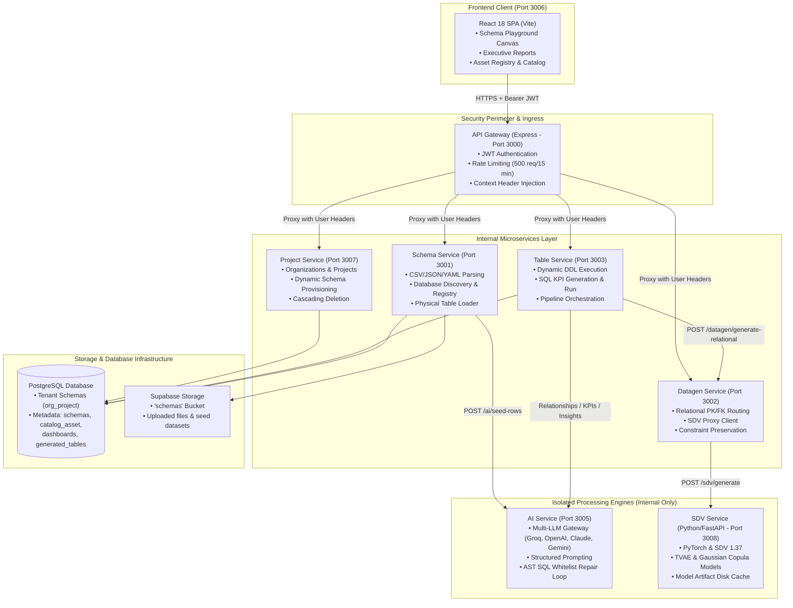

# RapidInsight Studio

<p align="center">
  <strong>Intelligent Schema-Driven Analytics, Synthetic Data Engineering & Live BI Workbench</strong>
</p>

<p align="center">
  
  
  
  
  
  
  
  
  
</p>

---

## 📖 Table of Contents

- [Overview](#-overview)
- [Key Features](#-key-features)
- [System Architecture](#-system-architecture)
- [Microservices & Port Matrix](#-microservices--port-matrix)
- [Tech Stack](#-tech-stack)
- [Project Directory Structure](#-project-directory-structure)
- [Quick Start Guide](#-quick-start-guide)
  - [Prerequisites](#prerequisites)
  - [1. Backend Setup](#1-backend-setup)
  - [2. Frontend Setup](#2-frontend-setup)
  - [3. Running the Entire Application](#3-running-the-entire-application)
- [Key Workflows](#-key-workflows)
- [Security & Reliability](#-security--reliability)
- [Contributing & License](#-contributing--license)

---

## 🌟 Overview

**RapidInsight Studio** is a full-stack, enterprise-grade data workbench designed to transform static database schemas into live, interactive analytics workspaces. 

### The Problem It Solves
1. **Compliance Bottlenecks:** Real customer transactional, financial, and healthcare data cannot be shared before signing enterprise DPAs and NDAs.
2. **Flaws in Traditional Mock Tools:** Conventional mock generators (e.g., standard Faker) generate columns independently without statistical or semantic correlation (e.g., a customer in "Tokyo" paired with country "Brazil", or VIP tiers spending less than standard tiers).
3. **LLM Volume & Token Limits:** Direct LLM row synthesis is slow, cost-prohibitive, and collapses after ~50 records.

### The RapidInsight Solution
RapidInsight Studio introduces a **decoupled, two-phase data generation pipeline**:
- **Semantic Realism (LLM):** Large Language Models generate diverse, context-aware seed rows (50–300 rows per table).
- **Statistical Scale (SDV / PyTorch):** Synthetic Data Vault (SDV) statistical copula and TVAE neural network models learn joint distributions from seed data and sample thousands of correlated records.
- **Relational Determinism:** Programmatic business logic guarantees primary-key uniqueness, foreign-key referential integrity, and mathematical invariants.
- **Instant BI & Reporting:** Natural language KPIs are converted into validated SQL queries executed directly against isolated PostgreSQL schemas to render executive charts and dashboards.

---

## ⚡ Key Features

- **Multi-Format Schema Ingestion:** Upload `.json`, `.yaml`, `.yml`, or `.csv` schema definitions with automatic data type detection and validation.
- **External Database Discovery & Asset Registry:** Connect directly to external databases (PostgreSQL, MySQL), discover live tables, validate schemas, and register them into the unified asset catalog.
- **Concurrent Duplicate & Update Protection:** Fingerprint-based data detection coupled with database transaction advisory locks ensures safe replacement of updated schemas while blocking duplicate table collisions.
- **Interactive Visual Schema Playground:** Pan-and-zoom graph canvas with minimap, draggable entity nodes, join path highlights, and attribute inspection.
- **Target KPIs & Metrics Engine:** Custom KPI input interface allowing business users to define metrics that are translated into secure SQL and executed against real tables.
- **Interactive Executive Reports:** Dynamic visual dashboards with Chart.js charts, KPI metric cards, and AI-authored executive insights.
- **Data Catalog & Deep Profiling:** Inspect asset column data types, null rates, cardinality, and data distribution statistics.
- **Tabular Data Viewer:** Real-time data exploration with pagination, row sorting, and structural inspection.
- **Multi-Tenant Workspace Isolation:** Dynamic PostgreSQL schema provisioning per organization and project (`org_project`), complete with cascading deletion.

---

## 🏗️ System Architecture



---

## 🔌 Microservices & Port Matrix

| Service | Port | Runtime / Framework | Core Responsibilities |
| :--- | :---: | :--- | :--- |
| **API Gateway** | `3000` | Node.js / Express | Public entry point, JWT verification, rate limiting, request routing |
| **Schema Service** | `3001` | Node.js / Express | Schema parsing, database table discovery, asset catalog, table loader |
| **Datagen Service** | `3002` | Node.js / Express | Relational key enforcement (PK/FK), constraint engine, SDV routing |
| **Table Service** | `3003` | Node.js / Express | Table creation, data insertion, SQL KPI generation & execution |
| **Report Service** | `3004` | Node.js / Express | Standalone report generation module |
| **AI Service** | `3005` | Node.js / Express | Multi-provider LLM gateway, prompt engineering, self-repair loops |
| **Frontend** | `3006` | React 18 / Vite | Web interface, schema playground, dashboards, catalog viewer |
| **Project Service** | `3007` | Node.js / Express | Organizations, project provisioning, workspace tenant management |
| **SDV Service** | `3008` | Python 3.12 / FastAPI | Statistical copula & TVAE model training, synthetic expansion |
| **Export Service** | `3009` | Node.js / Express | Bulk export and reporting utilities |

---

## 🛠️ Tech Stack

- **Frontend:** React 18, Vite, React Router 6, Chart.js, React-Chartjs-2, CSS Custom Properties (Theme tokens).
- **Backend Services:** Node.js (v20+), Express.js, Concurrently, Pino (structured logging), Helmet (security).
- **Machine Learning & Synthesis:** Python 3.12, FastAPI, Synthetic Data Vault (SDV 1.37+), PyTorch (CPU-optimized), Copulas.
- **AI & LLM Providers:** Groq, OpenAI, Anthropic Claude, Google Gemini (interchangeable provider adapters).
- **Databases & Storage:** PostgreSQL 15+, Supabase Auth & Storage.
- **SQL Security:** AST parser validation, table whitelisting, parameterized execution, PostgreSQL identifier quoting.

---

## 📁 Project Directory Structure

```text
Project-RapidInsightStudio/
├── RapidInsight-Frontend/              # React 18 Client Application (Vite)
│   ├── src/
│   │   ├── api/                        # Client API adapters (tableApi, schemaApi, catalogApi)
│   │   ├── components/                 # Reusable UI components & modals
│   │   │   ├── layout/                 # Sidebar, AppLayout
│   │   │   ├── playground/             # Interactive graph canvas & minimap
│   │   │   ├── reports/                # ReportChart, ReportKpiCard, ReportStatePanel
│   │   │   └── schema/                 # Upload dropzones, status cards, delete modals
│   │   ├── pages/                      # Application route pages
│   │   │   ├── ProjectWorkspacePage    # Overview & project details
│   │   │   ├── RegistryAssetPage       # Upload schema & database connector
│   │   │   ├── ProjectReportPage       # Uploaded schemas, KPIs & executive analytics
│   │   │   ├── DataCatalogPage         # Catalog assets & profiling metrics
│   │   │   ├── SchemaPlaygroundPage    # Visual schema graph explorer
│   │   │   └── TableViewerPage         # Tabular data viewer
│   │   └── context/                    # AuthContext, ThemeContext, ProjectRefreshContext
│   └── package.json
│
├── RapidInsight-Backend/               # Microservices Backend
│   ├── backend/
│   │   ├── services/
│   │   │   ├── gateway/                # Port 3000: Ingress proxy & JWT verification
│   │   │   ├── schema-service/         # Port 3001: Schema parsing & asset registry
│   │   │   ├── datagen-service/        # Port 3002: Relational key assignment & routing
│   │   │   ├── table-service/          # Port 3003: Physical tables & SQL KPI execution
│   │   │   ├── report-service/         # Port 3004: Report service stub
│   │   │   ├── ai-service/             # Port 3005: Multi-LLM gateway & prompt repair
│   │   │   ├── project-service/        # Port 3007: Project tenancy & schema provisioning
│   │   │   ├── sdv-service/            # Port 3008: FastAPI & PyTorch statistical synthesis
│   │   │   └── export-service/         # Port 3009: Export service stub
│   │   ├── scripts/                    # setup-sdv.js, run-sdv.js runner scripts
│   │   └── package.json                # Master concurrently runner
│   └── tests/                          # E2E, SQL safety & concurrency test suites
│
├── docs/                               # System Architecture, PRD, and Design specifications
├── .gitignore                          # Root git ignore (node_modules, .env, .venv)
└── README.md                           # Documentation entry point
```

---

## 🚀 Quick Start Guide

### Prerequisites

Ensure you have the following installed on your machine:
- **Node.js:** v18+ (Node.js 20 recommended)
- **Python:** v3.10+ (v3.12 recommended)
- **PostgreSQL:** Local instance or cloud database (e.g. Supabase)
- **Git**

---

### 1. Backend Setup

1. **Install backend dependencies:**
   ```bash
   cd RapidInsight-Backend/backend
   npm install
   ```
   *(This also executes `postinstall` to install dependencies across all microservices).*

2. **Configure Environment Variables:**
   Copy the example environment configurations in each service or set up your root configuration:
   ```bash
   # Ensure your database and Supabase keys are configured in:
   # backend/services/gateway/.env
   # backend/services/project-service/.env
   # backend/services/schema-service/.env
   # backend/services/table-service/.env
   # backend/services/ai-service/.env
   ```

3. **Set up the Python SDV environment:**
   Run the automated Python virtual environment installer:
   ```bash
   node scripts/setup-sdv.js
   ```

4. **Start the backend services:**
   ```bash
   npm run dev
   ```
   *This starts all 9 microservices in parallel via `concurrently`.*

---

### 2. Frontend Setup

1. **Open a new terminal and navigate to the frontend:**
   ```bash
   cd RapidInsight-Frontend
   ```

2. **Install frontend dependencies:**
   ```bash
   npm install
   ```

3. **Configure Frontend Environment (`.env`):**
   ```env
   VITE_API_BASE_URL=http://localhost:3000
   VITE_SUPABASE_URL=https://<your-project>.supabase.co
   VITE_SUPABASE_ANON_KEY=<your-anon-key>
   ```

4. **Start the frontend application:**
   ```bash
   npm run dev
   ```
   *The application will be live at `http://localhost:3006`.*

---

## 🔄 Key Workflows

### 1. Ingesting Schemas & Connecting Databases
- Navigate to **Registry Assest** in the sidebar.
- Upload a schema file (`.json`, `.csv`, `.yaml`) or provide database connection credentials to discover external tables.
- Click **Import Selected Tables** to register assets in the catalog and load validated physical tables into PostgreSQL.

### 2. Visual Exploration in Schema Playground
- Navigate to **Schema Playground**.
- Explore auto-inferred join relationships (primary keys to foreign keys), table schemas, and data structures on the visual canvas.

### 3. Configuring Target KPIs & Generating Reports
- Navigate to **Generated Report**.
- Under the **Target KPIs & Metrics** section, enter business metrics (e.g., *Monthly Active Users*, *MRR Churn Rate*, *Average Deal Size*).
- Click **Generate Tables** to run the synthetic expansion pipeline and SQL KPI execution loop.
- Watch real-time multi-step progress: inferring relationships → blueprint generation → table creation → synthetic data insertion → dashboard generation.
- Review the resulting executive KPI metric cards, visual charts, and AI-suggested business insights.

---

## 🔒 Security & Reliability

- **AST SQL Validation & Whitelist Protection:** LLM-generated SQL queries are parsed using an Abstract Syntax Tree (AST). Queries containing destructive statements (`DROP`, `DELETE`, `TRUNCATE`, `ALTER`) or targeting non-whitelisted tables are rejected and fed back into an automated repair loop.
- **PostgreSQL Advisory Locks:** Concurrent table loads with identical signatures are serialized via database transaction locks, preventing race conditions and duplicate physical tables.
- **SQL Identifier Quoting:** All table and column names undergo strict PostgreSQL identifier validation and quoting (`quoteIdentifier`), eliminating SQL injection risks from user-supplied column names.
- **JWT & Multi-Tenant Authorization:** The API Gateway validates tokens and injects verified tenant context headers (`x-user-id`, `x-internal-service-key`) to all internal services.

---

## 👥 Authors & Contributors

| Name | Role | GitHub Profile |
| :--- | :--- | :--- |
| **Sudhakar Govindasamy** | Project Lead & Full-Stack Developer | [@sudhakargovindasamy](https://github.com/sudhakargovindasamy) |
| **Kavi Varshini J** | Contributor & Teammate | [@JKaviVarshini](https://github.com/JKaviVarshini) |

---

## 📄 License

This project is licensed under the [MIT License](LICENSE).

