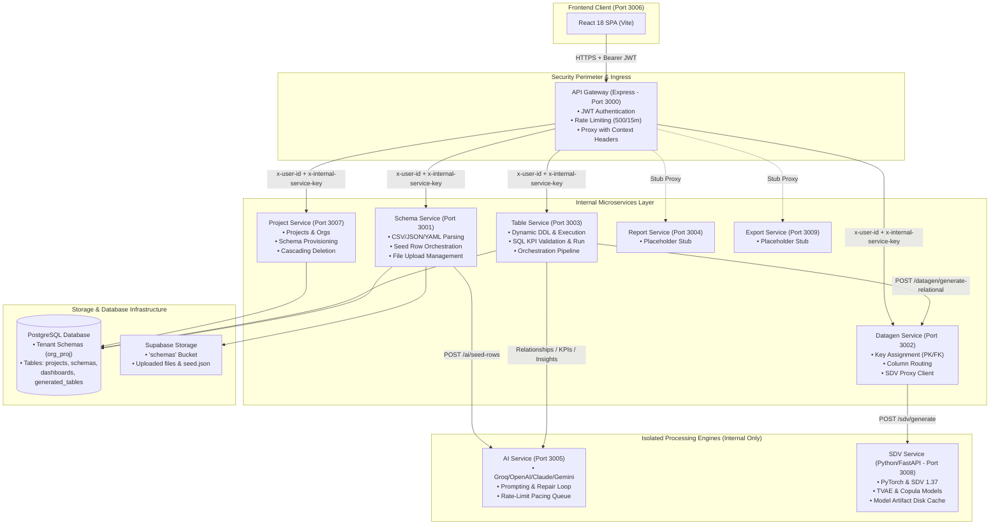
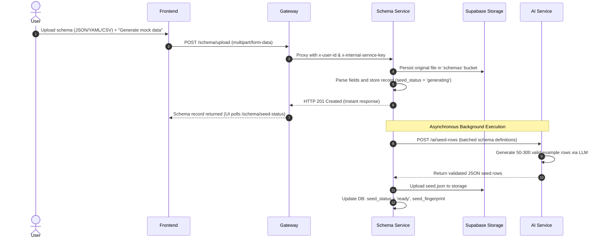
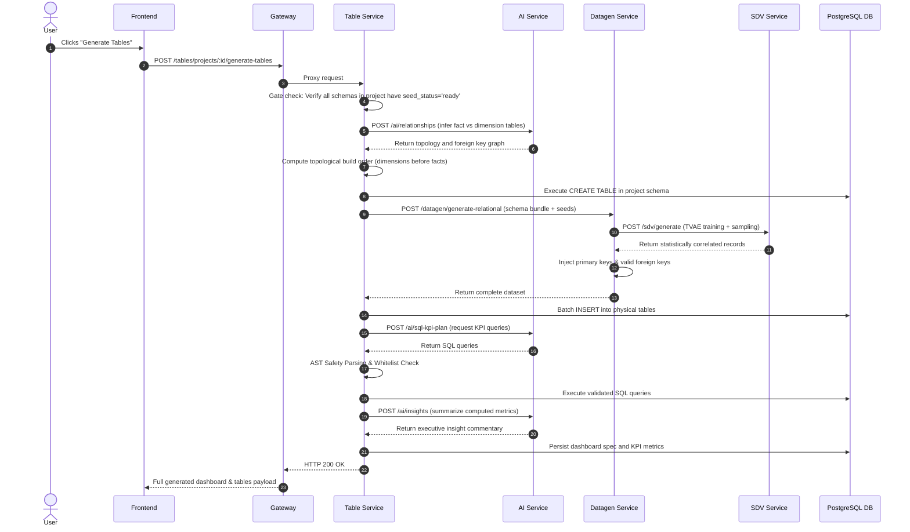
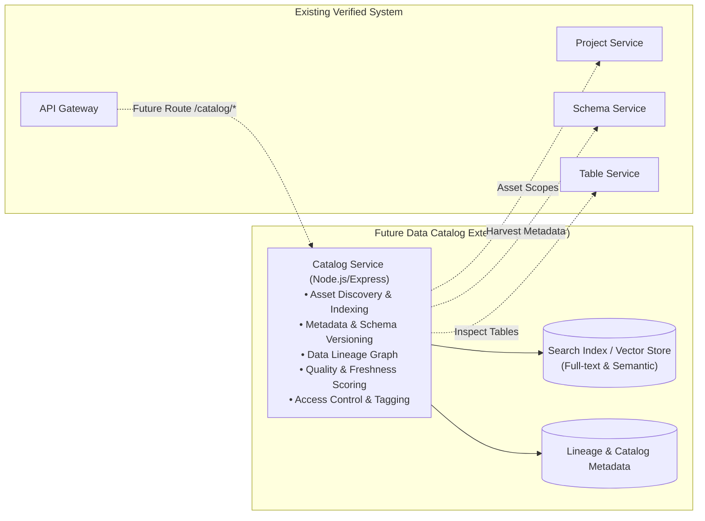

# RapidInsightStudio — System Architecture Document

---

## 1. System Overview

**RapidInsightStudio** is engineered around a microservices architecture with a single API Gateway protecting internal services, decoupled AI reasoning, deterministic data synthesis, and a single-page React frontend.

The system is organized around two foundational principles:
1. **Separation of Concerns:** Heavy statistical calculations (Python / SDV) and LLM inference (AI Service) are encapsulated away from public access, while core business logic is managed across modular Node.js Express microservices.
2. **Decoupled Two-Phase Pipeline:** Slow, asynchronous tasks (seed example row generation via LLM) execute quietly during schema upload; fast, high-volume statistical expansion (SDV) and SQL analytics execute on demand during table generation.

---

## 2. Current System Architecture Diagram

---

## 3. Microservice Catalog & Port Assignments

| Service Name | Port | Runtime / Framework | Ingress / Access | Core Responsibility |
| :--- | :---: | :--- | :--- | :--- |
| **API Gateway** | `3000` | Node.js / Express | Public / Ingress | Validates JWTs, applies rate limits, forwards requests with user headers. |
| **Schema Service** | `3001` | Node.js / Express | Internal (Gateway) | Validates uploads, parses schema definitions, triggers background seed synthesis. |
| **Datagen Service** | `3002` | Node.js / Express | Internal | Enforces relational constraints (PK/FK), calls SDV sidecar, routes columns. |
| **Table Service** | `3003` | Node.js / Express | Internal (Gateway) | Creates physical PostgreSQL tables, coordinates generation, validates & executes SQL. |
| **Report Service** | `3004` | Node.js / Express | Internal (Gateway) | Placeholder service for future standalone reporting modules. |
| **AI Service** | `3005` | Node.js / Express | Internal Only | Multi-provider LLM gateway, structured prompts, JSON validator & repair loops. |
| **Frontend** | `3006` | React 18 / Vite | Public / Client | Web client interface, visual schema canvas, analytics dashboards. |
| **Project Service** | `3007` | Node.js / Express | Internal (Gateway) | Manages organizations, projects, profiles, and cascading deletion. |
| **SDV Service** | `3008` | Python 3.12 / FastAPI | Internal Only | Statistical model training (TVAE, Copula), constraint application, disk caching. |
| **Export Service** | `3009` | Node.js / Express | Internal (Gateway) | Placeholder service for future bulk export capabilities. |

---

## 4. Key Execution Workflows

### 4.1 Schema Upload & Background Seed Synthesis

### 4.2 On-Demand Table Generation & Analytics Pipeline

---

## 5. Security & Authentication Architecture

1. **Authentication Flow:**
   - Client authenticates against `/auth/login` on Gateway.
   - Gateway queries `profiles` table using Supabase Admin Client, maps username to email, and delegates credential check to `supabase.auth.signInWithPassword`.
   - Client receives JWT session token, stored in browser local storage (`rapidinsight_session`).
2. **Gateway Verification:**
   - Every protected request includes `Authorization: Bearer <jwt>`.
   - Gateway verifies JWT with `supabase.auth.getUser(token)`.
   - On success, Gateway attaches `x-user-id`, `x-user-email`, and secret `x-internal-service-key` to proxied downstream calls.
3. **Internal Service Guardrails:**
   - Microservices employ `verifyInternalRequest` middleware verifying the presence of `x-internal-service-key`.
   - Direct requests bypassing the Gateway are rejected with `403 Forbidden`.
4. **LLM SQL Safety Sandboxing:**
   - Generated SQL queries are parsed using `node-sql-parser`.
   - Whitelist restrictions: Single SELECT statement, no table mutations, no sleep/system functions, strict table whitelist within current project schema.
   - Forced query timeout of 5 seconds.

---

## 6. Proposed Future Architecture: Data Catalog Service (PLANNED)

> [!NOTE]
> This section documents the planned future architecture. The Catalog Service is **NOT YET IMPLEMENTED**.

