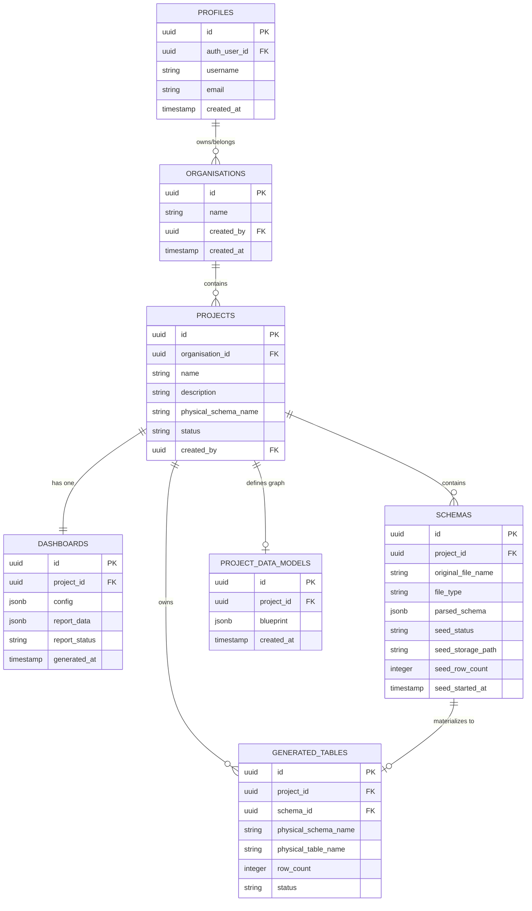

# RapidInsightStudio — Technical Design Document

---

## 1. Technical Design Patterns

The architecture utilizes proven distributed and data-processing design patterns:

1. **API Gateway Pattern:** Unified edge entry point handling cross-cutting concerns (authentication, CORS headers, rate limiting, request tracing via `X-Request-Id`).
2. **Sidecar Pattern:** Python `sdv-service` operates as a statistical computation sidecar alongside `datagen-service`, exposing a lightweight HTTP interface to encapsulate complex PyTorch/SDV routines.
3. **Pacing Queue & Circuit Resilience:** `ai-service` manages provider traffic through a serialized pacing queue (`AI_MIN_REQUEST_GAP_MS = 1200`), exponential backoff, and dynamic retry intervals respecting HTTP 429 headers.
4. **Repair Loop Pattern:** In LLM interaction flows (relationships, SQL queries, dashboard specifications), validation failures trigger automated feedback prompts detailing the exact syntax or structural error, allowing up to 3 self-repair attempts.
5. **Two-Phase Commit / Asynchronous Staging:** Schema upload triggers background seed generation with persistent state transitions (`seed_status`), ensuring synchronous user operations remain sub-second.

---

## 2. API Design & Service Contracts

### 2.1 API Conventions
- **Base URL:** `http://localhost:3000` (Gateway)
- **Protocol:** REST over HTTP / JSON payloads
- **Standard Success Response Shape:**
  ```json
  {
    "success": true,
    "message": "Optional human-readable confirmation",
    "data": { ... }
  }
  ```
- **Standard Error Response Shape:**
  ```json
  {
    "success": false,
    "message": "Specific error description",
    "code": "ERROR_CODE",
    "requestId": "uuid"
  }
  ```

### 2.2 Core Endpoint Registry

| Route | Method | Owning Service | Parameters / Payload | Description |
| :--- | :---: | :--- | :--- | :--- |
| `/auth/signup` | POST | Gateway | `{ username, email, password, confirmPassword }` | Registers user & creates profile |
| `/auth/login` | POST | Gateway | `{ username, password }` | Authenticates & returns JWT |
| `/me` | GET | Project Service | Header: `Authorization: Bearer <jwt>` | Returns active profile |
| `/projects` | GET | Project Service | Query: none | Lists user's projects |
| `/projects` | POST | Project Service | `{ name, customerName, description }` | Provisions project and schema |
| `/projects/:id` | GET | Project Service | Path: `id` | Retrieves project details |
| `/projects/:id/dashboard` | GET | Project Service | Path: `id` | Retrieves project dashboard state |
| `/projects/:id` | DELETE | Project Service | Path: `id` | Cascading project tear-down |
| `/schema/upload` | POST | Schema Service | `multipart/form-data` (`file`, `project_id`, `data_source`) | Ingests schema & triggers seed gen |
| `/schema/my` | GET | Schema Service | Query: `?project_id=<id>` | Lists project schemas |
| `/schema/seed-status` | GET | Schema Service | Query: `?project_id=<id>` | Checks status of seed row jobs |
| `/schema/:id/seed-rows/retry` | POST | Schema Service | Path: `schemaId` | Retries failed seed generation |
| `/tables/projects/:id/generate-tables` | POST | Table Service | `{ rowCount, custom_kpis }` | Executes complete table & data pipeline |
| `/tables/projects/:id/data-model` | GET | Table Service | Path: `projectId` | Returns relational topology |
| `/tables/generated/:id/rows` | GET | Table Service | Query: `?page=1&pageSize=50` | Paginates physical table rows |

---

## 3. Data Models & Entity Relationships

The PostgreSQL database (managed via Supabase) comprises the following core entities:



---

## 4. Error Handling & Validation Architecture

1. **Request Validation:** Enforced via `zod` schemas on Gateway and microservices. Malformed payloads fail with `400 Bad Request` prior to business logic execution.
2. **Proxy Failures:** Handled by Gateway's `proxyWithUserContext` middleware. Unreachable downstream services return structured `502 Bad Gateway` error responses with correlation `X-Request-Id`.
3. **Database Guardrails:**
   - Parameterized queries via `pg` or Supabase PostgREST client prevent SQL injection in core services.
   - Dynamic DDL identifiers (`table_name`, `schema_name`) are sanitized via `identifierNaming.js` using regular expression whitelists (`^[a-zA-Z_][a-zA-Z0-9_]*$`).
4. **LLM SQL Safety Validator:**
   - Queries parsed using `node-sql-parser`.
   - AST traversal validates:
     - Statement type == `select`
     - From clauses reference only validated project tables.
     - Function calls belong to approved aggregation list (`COUNT`, `SUM`, `AVG`, `ROUND`, `MIN`, `MAX`).
     - No schema modification statements (`DROP`, `ALTER`, `TRUNCATE`, `INSERT`, `UPDATE`, `DELETE`).
     - Rejection of wildcard selects (`SELECT *`) to avoid unintended payload dumps.

---

## 5. Statistical Data Processing Strategy

1. **Model Selection: TVAE vs. Gaussian Copula:**
   - Empirical benchmarking demonstrated Gaussian Copula scrambles categorical-to-numeric correlations (e.g., segment tier vs. price).
   - TVAE (Tabular Variational Autoencoder) is selected as default synthesizer (`DEFAULT_SYNTHESIZER = "tvae"` with 300 epochs), correctly preserving relative magnitude distributions.
2. **Explicit Type Constraints:**
   - SDV's native type inference (`Metadata.detect_from_dataframe`) is disabled because column names like `city` trigger PII anonymizers.
   - Exact `sdtype` mappings (`numerical`, `categorical`, `datetime`, `boolean`) are passed explicitly from schema definitions.
3. **Constraint Routing:**
   - **Categorical Determinism (e.g., City ↔ Country):** Enforced natively via `fixed_combinations` constraints in SDV.
   - **Date Ordering (e.g., Delivery Date > Order Date):** Excluded from SDV `inequality` constraints due to observed correlation distortions. Computed programmatically post-sampling: `delivery_date = order_date + sampled_interval`.

---

## 6. Data Catalog Specification & End-to-End Workflow

### 6.1 Overview & Schema Ingestion Integration
* **Trigger:** Schema upload (JSON, YAML, CSV) or external database connection/discovery (Supabase/PostgreSQL) initiated in the Overview & Schema workspace (`UploadSchemaPanel`).
* **Metadata Persistence:**
  - On upload or discovery, metadata is normalized into three core entities derived from the reference ERD (`Notes/files/data_catalog_erd.png`):
    1. **`data_source`**: Identifies the source system, connection type (`FILE_UPLOAD`, `POSTGRESQL`), environment, and project scope.
    2. **`catalog_asset`**: Represents cataloged tables, views, or schema files linked to a `data_source`.
    3. **`asset_column`**: Represents granular column-level attributes (`column_name`, `data_type`, `ordinal_position`, `is_pk`, `is_nullable`, `classification`).
* **Design Principle:** Reuses existing schema parsing (`schemaParserService`) and database discovery (`dbConnectionService`) without duplicating existing upload or project logic.

### 6.2 Data Catalog UI & Query Configuration Workflow
* **Sidebar Entry:** Dedicated **Data Catalog** navigation item in the project sidebar linking to `/projects/:projectId/catalog`.
* **Empty State:** Centered "Add" button initiating the query configuration workflow.
* **Dependent Cascading Selector:**
  1. **Source / Project:** Select active data source within the project.
  2. **Asset:** Populated based on selected source.
  3. **Asset Column:** Populated based on selected asset, displaying column data type badges.
  4. **Profiling Statistic:** Available metrics guided by `COLUMN_PROFILE_STAT` and filtered by column type:
     - Universal: `NULL COUNT`, `COUNT`, `DISTINCT COUNT`.
     - Numerical Only: `MIN`, `MAX`, `AVG`.
  5. **Run Action:** Triggers backend metadata validation and SQL profiling execution.

### 6.3 Profiling Execution & Live Database Guardrails
* **Metadata vs. Row Separation:** The catalog stores structural metadata. Business data rows reside in the underlying database.
* **Execution Contract:**
  1. Backend receives `{ assetId, columnId, statType }`.
  2. Validates metadata validity and checks whether the asset maps to an accessible physical database connection or materialized table.
  3. **Live Database Guardrail:** If an uploaded schema has no accessible live database or materialized table, the system explicitly returns an informative message (*"No live database connection or populated table available for this asset"*), preventing false claims of live execution.
  4. When accessible, generates sanitized, parameterized SQL queries using quoted identifiers.
  5. Executes query against the target database and returns execution duration, generated SQL, and computed statistic to the UI.

### 6.4 Verified Authorization Model & Credential Security Decisions
1. **Verified Authorization Architecture:**
   - User identity is established by the API Gateway using Supabase JWT (`auth.uid()`).
   - Project membership is anchored strictly on existing tables: `projects.created_by = auth.uid()` and organisation ownership (`projects.organisation_id IN (SELECT id FROM organisations WHERE created_by = auth.uid())`). No non-existent `organisation_members` table is assumed.
   - For PostgREST/authenticated user requests, RLS policies enforce tenant boundaries using a hardened `SECURITY DEFINER` function `public.user_has_project_access(project_id)` configured with `SET search_path = public, pg_temp` and restricted execute grants (`REVOKE FROM PUBLIC; GRANT TO authenticated, service_role`).
2. **Narrow Ownership Consistency Boundary:**
   - `data_source.organisation_id` is automatically derived and validated from `projects.organisation_id` via the `BEFORE INSERT OR UPDATE` trigger `trg_data_source_sync_organisation`.
   - `catalog_asset` references `(source_id, project_id)` via a composite foreign key, making cross-project asset linkage structurally impossible.
   - The trigger `trg_catalog_asset_project_consistency` ensures that any referenced `schema_id` or `generated_table_id` strictly belongs to the matching `project_id`.
   - **Narrow Boundary Principle:** To prevent unintended interference with existing core application workflows, no triggers are placed on legacy `public.schemas` or `public.generated_tables`. All consistency rules remain strictly within the catalog domain.
3. **Write Access Model:**
   - **Read Access (`SELECT`):** Granted to all users with verified access to the project (`user_has_project_access(project_id)`).
   - **Write Access (`INSERT`):** Granted to any user with project access, recording `created_by = auth.uid()`.
   - **Mutation Access (`UPDATE`, `DELETE`):** Restrained to the entity creator (`created_by = auth.uid()`) or the project creator, ensuring auditability and protecting assets from unauthorized tampering.
4. **Credential Management Findings:**
   - The PostgreSQL extension `supabase_vault` is installed at the database level (`vault.secrets`), but the application codebase currently does not utilize it.
   - In accordance with constraints, no foreign key dependency to `vault.secrets` is created. Raw credentials will **never** be stored in the registry. An opaque, nullable `credential_secret_ref TEXT` is provided for future secret-manager integration.
5. **Separation of Database vs. Backend Safeguards:**
   - **Enforced by Database Migration (Stage 1):** Schema DDL, table constraints, RLS policies, trigger-based organisation sync and cross-project consistency validation.
   - **Enforced by Backend Code (Stages 2 & 3):** Since backend microservices (`schema-service`, `table-service`) connect via `service_role` or direct PostgreSQL pools (`pg.Pool`), RLS is bypassed. The backend must enforce `getProjectForEmployee` authorization checks, verify `generated_tables.status = 'POPULATED'`, sanitize SQL identifiers, and refuse profiling when targets are unpopulated.
6. **Lifecycle & Audit Preservation (`ON DELETE SET NULL`):**
   - `catalog_asset.schema_id` and `catalog_asset.generated_table_id` specify `ON DELETE SET NULL`. If a physical table in `public.generated_tables` is deleted or re-generated, the catalog asset and its detailed column dictionary (`asset_column`) remain preserved for audit history, while transitioning the asset state to unpopulated.
7. **Ingestion Validation:**
   - In Stage 2, ingestion pipelines in `schema-service` must strictly validate all column metadata (names, types, nullability) against the actual parsed schema or database introspection results prior to inserting into `asset_column`.
