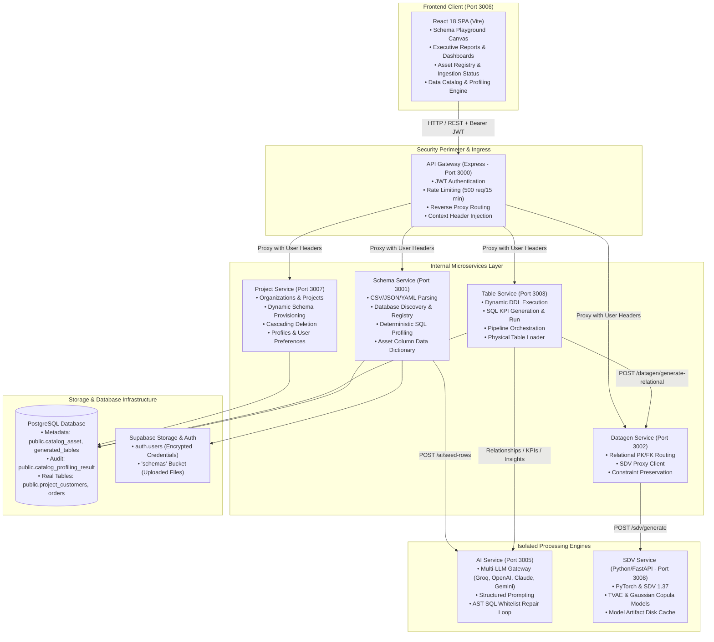

# 00. Master System Architecture & Project Blueprint

**Project Name:** RapidInsight Studio  
**Classification:** Enterprise-Grade Schema-Driven Analytics, Synthetic Engineering & Live BI Workbench  
**Document Status:** Complete Architecture Reference  
**Parent Directory:** `docs/Project_Documentation/`

---

## 📑 Documentation Suite Index

This documentation suite provides a complete, exhaustive breakdown of every code file, database connection, relationship, and section across the RapidInsight Studio project:

1. **`00_MASTER_SYSTEM_ARCHITECTURE.md`** (This file) — High-level system architecture, microservices matrix, communications, security perimeter, and repository layout.
2. **`01_DATABASE_SCHEMA_AND_RELATIONSHIPS.md`** — Comprehensive reference for all 11 core database tables, primary/foreign keys, cascade rules, tenant isolation, and ERD connections.
3. **`02_BACKEND_MICROSERVICES_CODE_GUIDE.md`** — File-by-file breakdown of all 9 backend microservices, services, controllers, routes, and SQL execution engines.
4. **`03_FRONTEND_APPLICATION_CODE_GUIDE.md`** — File-by-file breakdown of all React pages, components, API client adapters, hooks, state contexts, and CSS token styling.
5. **`04_END_TO_END_WORKFLOWS_AND_LIFECYCLE.md`** — Step-by-step user journeys: Workspace Setup ➔ Asset Registration ➔ Data Ingestion ➔ Profiling ➔ Executive Dashboards, plus future update protocols.

---

## 🌟 1. System Overview & The Core Problem

RapidInsight Studio solves three enterprise challenges:
1. **Compliance Bottlenecks:** Real customer records (financial, medical, PII) cannot be shared prior to extensive regulatory reviews.
2. **Flaws in Traditional Mock Tools:** Tools like standard Faker generate columns independently without statistical or business correlation (e.g., an address in "Tokyo" paired with country "Brazil", or standard tier accounts spending more than VIP tiers).
3. **LLM Synthesis Limits:** LLMs cannot realistically synthesize thousands of rows due to token context limits and cost.

### RapidInsight Studio's Multi-Tier Solution:
* **Asset Blueprint First:** Users define expected schemas and column specifications in the Data Catalog before data ingestion.
* **Multi-Modal Data Ingestion:** Populate real PostgreSQL tables via direct file upload (CSV, XLSX, JSON), realistic synthetic mock generation, or external database imports.
* **Deterministic Quality Profiling:** Built-in SQL profiling engine (`sqlDataProfilingService.js`) audits null rates, averages, standard deviations, outliers (IQR rule), and category frequencies without AI dependency.
* **Hybrid Two-Phase Synthesis:** LLM seed generation (context realism) paired with SDV/PyTorch (statistical scale) to generate thousands of correlated relational rows.
* **Executive BI Delivery:** Translates natural language KPIs into verified SQL executed directly against native PostgreSQL tables for real-time dashboards.

---

## 🏗️ 2. High-Level Architecture Diagram



---

## 🔌 3. Microservices Port & Responsibilities Matrix

| Service | Port | Runtime / Framework | Core Responsibilities |
| :--- | :---: | :--- | :--- |
| **API Gateway** | `3000` | Node.js / Express | Public entry point, JWT verification, rate limiting, request routing, proxying |
| **Schema Service** | `3001` | Node.js / Express | Schema parsing, database table discovery, asset catalog, deterministic profiling |
| **Datagen Service** | `3002` | Node.js / Express | Relational key enforcement (PK/FK), constraint engine, SDV routing |
| **Table Service** | `3003` | Node.js / Express | Physical table creation, data insertion, SQL KPI generation & execution |
| **Report Service** | `3004` | Node.js / Express | Standalone report generation module |
| **AI Service** | `3005` | Node.js / Express | Multi-provider LLM gateway, structured prompts, SQL self-repair loops |
| **Frontend Client** | `3006` | React 18 / Vite | Web interface, schema playground, dashboards, catalog viewer, ingestion tracker |
| **Project Service** | `3007` | Node.js / Express | Organizations, project provisioning, workspace tenant management, user profiles |
| **SDV Service** | `3008` | Python 3.12 / FastAPI | Statistical copula & TVAE model training, synthetic expansion |
| **Export Service** | `3009` | Node.js / Express | Bulk export and reporting utilities |

---

## 🔒 4. Security & Communication Architecture

1. **Ingress Security:** Only the API Gateway (`port 3000`) and Frontend (`port 3006`) are exposed to user traffic. Internal microservices (`ports 3001–3005, 3007–3009`) communicate internally behind the perimeter.
2. **Authentication Flow:**
   - Supabase Auth handles user registration, password encryption, and JWT token issuance.
   - Frontend includes `Authorization: Bearer <token>` on all requests.
   - The Gateway validates the JWT, decodes user identity, and injects `X-User-Id`, `X-User-Email`, and `X-User-Role` headers before proxying requests to downstream microservices.
3. **Tenant Data Isolation:**
   - Every project record belongs to an organization (`organisations(id)`).
   - Every database record (schema, asset, physical table, dashboard) contains a `project_id`.
   - PostgreSQL `ON DELETE CASCADE` rules guarantee zero orphaned records upon project deletion.

---

## 📁 5. Root Repository Layout

```text
Project-RapidInsightStudio/
├── RapidInsight-Frontend/              # React 18 Client Application (Vite)
│   ├── src/
│   │   ├── api/                        # API client wrappers (catalogApi, schemaApi, tableApi)
│   │   ├── components/                 # Modals, charts, layout, schema dropzones
│   │   ├── context/                    # AuthContext, ThemeContext, ProjectRefreshContext
│   │   ├── hooks/                      # Custom hooks (drag, schema upload, playground)
│   │   ├── pages/                      # Application route pages
│   │   └── utils/                      # File validation, name formatters, data detection
│   └── package.json
│
├── RapidInsight-Backend/               # Backend Microservices Architecture
│   ├── backend/
│   │   ├── migrations/                 # PostgreSQL migrations (001 - 010)
│   │   ├── services/
│   │   │   ├── gateway/                # Port 3000: Gateway proxy
│   │   │   ├── schema-service/         # Port 3001: Schema & Data Catalog service
│   │   │   ├── datagen-service/        # Port 3002: Relational data synthesis
│   │   │   ├── table-service/          # Port 3003: Table creation & SQL execution
│   │   │   ├── report-service/         # Port 3004: Report service
│   │   │   ├── ai-service/             # Port 3005: LLM gateway
│   │   │   ├── project-service/        # Port 3007: Project tenancy & profiles
│   │   │   ├── sdv-service/            # Port 3008: Python FastAPI SDV
│   │   │   └── export-service/         # Port 3009: Export utilities
│   │   └── scripts/                    # SDV setup and runner scripts
│   └── package.json
│
├── docs/                               # System Documentation
│   ├── Project_Documentation/          # Master comprehensive project documentation
│   └── Simple_Database_Architecture/   # Executive diagrams, SVG, and presentation guides
└── README.md                           # Public repository overview
```
