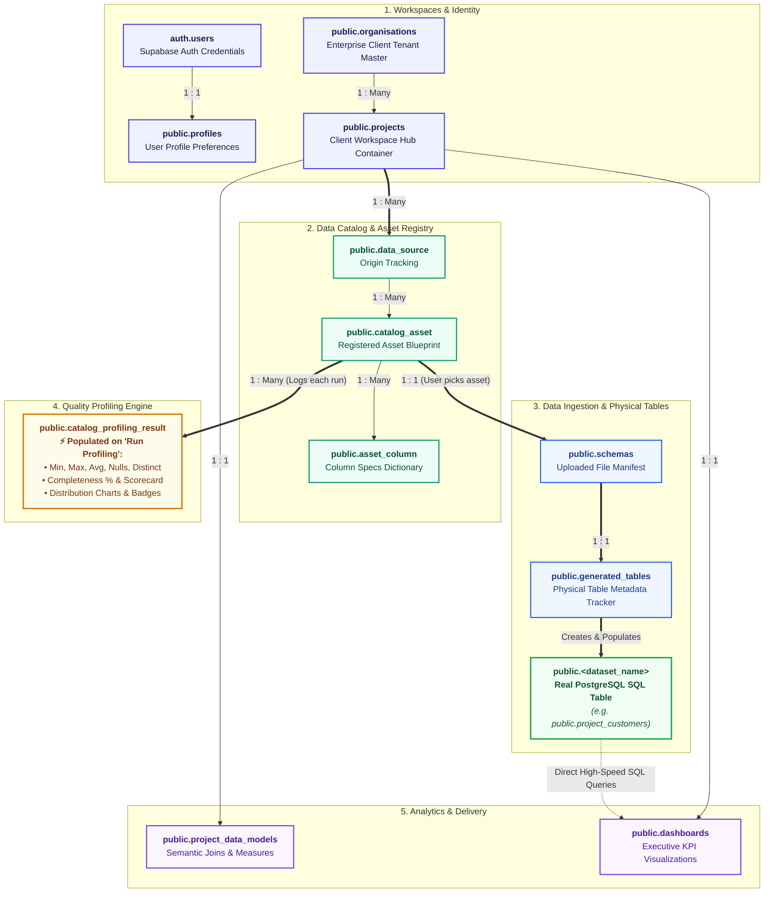

# 01. Database Schema & Entity-Relationship Architecture

**Project:** RapidInsight Studio  
**Classification:** Database Architecture, Entity Relationships & Code Mapping  
**Parent Directory:** `docs/Project_Documentation/`

---

## 🗄️ 1. Executive Summary & Database Principles

RapidInsight Studio relies on PostgreSQL 15+ managed under Supabase infrastructure. The database architecture is designed with three core architectural principles:

1. **Strict Multi-Tenant Isolation:** Every data entity belongs to an organization and project container. No user can ever query or modify data belonging to another project.
2. **Physical Storage Over Static Files:** Rather than running analytics against slow raw files (CSV/Excel) in memory, the system compiles schemas into native PostgreSQL tables (`generated_tables`) with indexes for sub-millisecond query performance.
3. **Atomic Cascading Deletions:** Clean foreign-key constraints with `ON DELETE CASCADE` guarantee that deleting a project instantly purges all schemas, physical tables, catalog assets, profiling records, and dashboards with zero orphaned records.

---

## 🏗️ 2. The Complete Entity-Relationship Model

---

## 📋 3. Detailed Table-by-Table Technical Specifications

---

### 1. `auth.users` (Supabase Identity)
* **Schema:** `auth`
* **Purpose:** Core authentication table managed by Supabase Auth. Stores securely hashed user passwords, email verification tokens, and JWT claims.
* **Primary Key:** `id` : `uuid`
* **Connections:**
  * Referenced 1:1 by `public.profiles(auth_user_id)`.
  * Audit references on `data_source(created_by)` and `catalog_asset(created_by)`.
* **Why It Exists:** Keeps sensitive authentication credentials, salting, and password hashes strictly isolated from the application’s business database.

---

### 2. `public.organisations`
* **Schema:** `public`
* **Purpose:** The root enterprise client container. Stores enterprise company metadata, unique slug, subscription tier, and creator identity.
* **Primary Key:** `id` : `uuid`
* **Foreign Keys:** None.
* **Child Tables:** `public.projects(organisation_id)` and `public.data_source(organisation_id)`.
* **Cascade Behavior:** `ON DELETE CASCADE`. Deleting an enterprise organization purges all projects, files, and physical tables belonging to that organization.
* **Why It Exists:** Enables multi-tenant B2B tenancy where an enterprise client (e.g. Innova Solutions) owns multiple isolated project teams.

---

### 3. `public.profiles`
* **Schema:** `public`
* **Purpose:** Extends `auth.users` with application preferences, usernames, display names, and avatars.
* **Primary Key:** `id` : `uuid`
* **Foreign Key:** `auth_user_id` ➔ `auth.users(id)` (`ON DELETE CASCADE`, `UNIQUE`).
* **Relationship:** Strictly **1 : 1** with `auth.users`.
* **Code References:** `profileService.js` (`getProfileByAuthId`, `upsertProfile`).
* **Why It Exists:** Keeps presentation metadata (avatar, display name) editable without granting the frontend direct write access to `auth.users`.

---

### 4. `public.projects`
* **Schema:** `public`
* **Purpose:** Primary collaborative workspace hub. Serves as the foreign key anchor for all data assets, schemas, models, and analytics.
* **Primary Key:** `id` : `uuid`
* **Foreign Key:** `organisation_id` ➔ `public.organisations(id)` (`ON DELETE CASCADE`).
* **Child Tables (10 Tables):** `schemas`, `generated_tables`, `data_source`, `catalog_asset`, `catalog_profiling_result`, `dashboards`, `project_data_models`.
* **Cascade Behavior:** `ON DELETE CASCADE`.
* **Why It Exists:** Every business record links to `project_id`. Client A can never see Client B’s data, and deleting a workspace drops all associated tables with zero orphaned data.

---

### 5. `public.data_source`
* **Schema:** `public`
* **Purpose:** Catalog abstraction representing the origin data container (e.g., uploaded workspace files, cloud storage bucket, or external PostgreSQL connector).
* **Primary Key:** `source_id` : `uuid`
* **Foreign Keys:**
  * `project_id` ➔ `public.projects(id)` (`ON DELETE CASCADE`)
  * `organisation_id` ➔ `public.organisations(id)` (`ON DELETE CASCADE`)
* **Child Tables:** `catalog_asset(source_id)`.
* **Relationship:** **1 to Many** (`1:N`) with `catalog_asset`.
* **Why It Exists:** Records data provenance and lineage so teams know whether a dataset came from a live database or an uploaded CSV.

---

### 6. `public.catalog_asset`
* **Schema:** `public`
* **Purpose:** The official registered asset blueprint in the Data Catalog. Holds asset name, fully qualified database name (`fq_name`), description, and status tags *before* data is ingested.
* **Primary Key:** `asset_id` : `uuid`
* **Foreign Keys:**
  * `source_id` ➔ `public.data_source(source_id)` (`ON DELETE CASCADE`)
  * `project_id` ➔ `public.projects(id)` (`ON DELETE CASCADE`)
  * `schema_id` ➔ `public.schemas(id)` (`ON DELETE SET NULL`)
  * `generated_table_id` ➔ `public.generated_tables(id)` (`ON DELETE SET NULL`)
* **Child Tables:** `asset_column(asset_id)`, `catalog_profiling_result(asset_id)`.
* **Relationship:** **1 to Many** (`1:N`) with `asset_column` and `catalog_profiling_result`.
* **Why It Exists:** Defines the expected dataset structure (the blueprint) so non-technical users can browse and understand available assets.

---

### 7. `public.asset_column`
* **Schema:** `public`
* **Purpose:** The data dictionary for registered assets. Stores column names, inferred SQL data types (`int`, `text`, `numeric`, `date`), nullability flags, and ordinal positions.
* **Primary Key:** `column_id` : `uuid`
* **Foreign Key:** `asset_id` ➔ `public.catalog_asset(asset_id)` (`ON DELETE CASCADE`).
* **Relationship:** **1 to Many** (`1:N`) with `catalog_asset`.
* **Why It Exists:** Acts as the validation contract against which incoming files in Data Ingestion are verified before writing rows into PostgreSQL.

---

### 8. `public.schemas`
* **Schema:** `public`
* **Purpose:** Upload manifest tracking user-uploaded data files (CSV, XLSX, JSON), Supabase storage bucket file paths, delimiters, row counts, and build status.
* **Primary Key:** `id` : `uuid`
* **Foreign Key:** `project_id` ➔ `public.projects(id)` (`ON DELETE CASCADE`).
* **Relationship:** **1 to 1** with `generated_tables`.
* **Why It Exists:** Decouples raw file storage from database instantiation, allowing files to be audited, re-parsed, or re-ingested safely.

---

### 9. `public.generated_tables`
* **Schema:** `public`
* **Purpose:** Metadata tracking table for physical SQL tables dynamically instantiated in PostgreSQL. Stores physical table name, physical schema name, row count, column count, and build status.
* **Primary Key:** `id` : `uuid`
* **Foreign Keys:**
  * `project_id` ➔ `public.projects(id)` (`ON DELETE CASCADE`)
  * `schema_id` ➔ `public.schemas(id)` (`ON DELETE CASCADE`)
* **Relationship:** **1 to 1** with physical table `public."<dataset_name>"`.
* **Why It Exists:** Serves as the programmatic bridge between application metadata and the native PostgreSQL table catalog (`information_schema.tables`).

---

### 10. `public."<dataset_name>"` (Real Physical Tables)
* **Schema:** `public` (or dynamic project schema `org_project`)
* **Example Names:** `public.project_customers`, `public.orders`, `public.transactions`
* **Purpose:** The actual, high-performance PostgreSQL table holding live business data rows.
* **Attributes:** Real typed SQL columns (`id bigint PRIMARY KEY`, `amount numeric`, `email text`, `created_at timestamptz`).
* **Why It Exists:** Sub-millisecond query execution. Dashboards, reports, and statistical profiling execute native SQL aggregate queries directly against these tables.

---

### 11. `public.catalog_profiling_result`
* **Schema:** `public`
* **Purpose:** Permanent statistical profiling history log. Stores the exact JSON results generated when a user clicks **"Run Profiling"** in the Data Catalog.
* **Primary Key:** `result_id` : `uuid`
* **Foreign Keys:**
  * `project_id` ➔ `public.projects(id)` (`ON DELETE CASCADE`)
  * `asset_id` ➔ `public.catalog_asset(asset_id)` (`ON DELETE SET NULL`)
  * `column_id` ➔ `public.asset_column(column_id)` (`ON DELETE SET NULL`)
* **Key Columns:** `profile_metrics` (JSONB of Min, Max, Avg, Nulls, Distinct), `distribution` (JSONB of histograms & categories), `created_at` (timestamptz).
* **Why It Exists:** Provides an immutable audit trail showing how data health and completeness evolved over time.

---

### 12. `public.project_data_models`
* **Schema:** `public`
* **Purpose:** Semantic data modeling store. Saves table join relationships, dimension hierarchies, and calculated business metrics.
* **Primary Key:** `id` : `uuid`
* **Foreign Key:** `project_id` ➔ `public.projects(id)` (`ON DELETE CASCADE`, `UNIQUE`).
* **Relationship:** Strictly **1 : 1** with `public.projects`.
* **Why It Exists:** Allows business analysts to join tables without writing complex SQL by hand.

---

### 13. `public.dashboards`
* **Schema:** `public`
* **Purpose:** Analytics dashboard layout configuration. Stores widget arrangements, chart types, KPI formulas, and visual themes.
* **Primary Key:** `id` : `uuid`
* **Foreign Key:** `project_id` ➔ `public.projects(id)` (`ON DELETE CASCADE`, `UNIQUE`).
* **Relationship:** Strictly **1 : 1** with `public.projects`.
* **Why It Exists:** Powers the executive reporting UI, executing live aggregate queries against physical tables to display charts.

---

## 🗑️ 4. Inactive Legacy Backup Tables (Archive Candidates)

The following 5 tables exist in the `public` schema from early development iterations. Source code AST verification confirms **zero runtime references** in any service or frontend code:
1. `if_before_project_schema`
2. `backup_profiles_before_project_schema`
3. `backup_projects_before_project_schema`
4. `backup_schemas_before_project_schema`
5. `backup_generated_tables_before_project_schema`

*Migration 009 (`009_archive_legacy_backup_tables.sql`) moves these to the `archive` schema to prevent exposure in PostgREST.*
